# LLM Gateway

> 手写 Java 实现的多 Provider 大模型 API 统一网关

[](https://openjdk.org/projects/jdk/21/)
[](https://spring.io/projects/spring-boot)
[](LICENSE)

---

## 为什么有这个项目

企业使用大模型时，面临几个痛点：

- **多模型管理混乱** — 每个 Provider 的 API 格式不同，业务代码散落各处
- **切换成本高** — 想从 Nvidia 换到 OpenRouter，要改业务代码
- **不可观测** — 没人知道每次调用花了多少钱、多少时间

这个项目的核心思路很简单：**提供一个统一的 API，在背后把不同 Provider 的差异消化掉。**

```mermaid
graph LR
    Client[你的应用] --> Gateway[LLM Gateway<br/>统一入口]
    Gateway --> Nvidia[Nvidia API]
    Gateway --> OpenRouter[OpenRouter API]
    Gateway --> Plus[... 更多 Provider]

    style Client fill:#1a1a2e,stroke:#e94560
    style Gateway fill:#16213e,stroke:#0f3460
    style Nvidia fill:#1a1a2e,stroke:#76b900
    style OpenRouter fill:#1a1a2e,stroke:#ff6600
    style Plus fill:#1a1a2e,stroke:#555
```



---

## 项目结构

```
llm-gateway/
├── src/main/java/com/kyon/llmgateway/
│   ├── adapter/                  # 适配器层——对接不同 Provider
│   │   ├── BaseLLMAdapter.java       # 抽象基类：HTTP 调用、JSON 解析、上游状态码检查
│   │   ├── ConfigurableAdapter.java  # 唯一实现子类：按 provider 剥模型名前缀
│   │   └── AdapterConfig.java        # @Bean 注册各 Provider 实例（配置即接入）
│   ├── agent/                    # Agent 能力层（tool loop / 会话 / 状态机）
│   │   ├── impl/ReActAgent.java      # ReAct 循环：思考 → 行动 → 观察
│   │   ├── impl/SimpleAgent.java     # 直答模式
│   │   ├── engine/                   # ToolEngine / ContextManager / TokenCounter
│   │   ├── session/                  # SQLite 会话持久化（重启不丢历史）
│   │   ├── state/AgentState.java     # Agent 状态机
│   │   └── tool/                     # Tool 接口 + 5 个内置工具（计算器/时间/文件/抓取/搜索）
│   ├── controller/               # REST API 入口
│   │   ├── ChatController.java       # /api/chat/completions 纯转发（OpenAI 兼容）
│   │   ├── AgentController.java      # /api/agent/* Agent 能力
│   │   └── ModelController.java      # /api/models 可用模型列表
│   ├── model/                    # 数据模型（ChatRequest/Response、Message、统一响应体）
│   ├── config/                   # 全局异常处理、模型配置、链路追踪
│   ├── observability/            # Token 桶限流 + 超限异常
│   └── service/
│       ├── LLMService.java           # 核心接口：chat / stream
│       └── LLMServiceFactory.java    # 按 yml 白名单把 model 路由到 provider 实例
├── data/                         # SQLite 会话库 + Agent 工作目录（不入库）
├── logs/                         # 运行日志（不入库）
└── .env                          # 环境变量（不入库，参考 .env.example）
```

---

## 架构设计

### 适配器模式

核心思路是**面向接口编程**：

```java
public interface LLMService {
    // 同步调用：可携带工具定义与 tool_choice（透传给上游，不执行工具）
    ChatResponse chat(List<Message> messages, List<ToolDefinition> tools) throws Exception;

    // 流式调用：返回 SseEmitter，帧为 OpenAI chat.completion.chunk 格式
    SseEmitter stream(List<Message> messages, List<ToolDefinition> tools);
}
```

每个 Provider 是这个接口的一个实现（当前是同一个 `ConfigurableAdapter` 类的不同实例），`ChatController` 只依赖接口，不关心背后是哪个 LLM。

```mermaid
graph TD
    Controller[ChatController] --> Factory[LLMServiceFactory]
    Factory --> |nvidia/xxx| Nvidia[ConfigurableAdapter<br/>provider=nvidia]
    Factory --> |openrouter/xxx| OpenRouter[ConfigurableAdapter<br/>provider=openrouter]
    
    subgraph LLMService[LLMService 接口]
        Base[BaseLLMAdapter<br/>抽象基类<br/>HTTP 请求 + JSON 解析]
    end
    
    Nvidia -->|继承| Base
    OpenRouter -->|继承| Base

    style Controller fill:#16213e,stroke:#e94560
    style Factory fill:#1a1a2e,stroke:#0f3460
    style Nvidia fill:#1a1a2e,stroke:#76b900
    style OpenRouter fill:#1a1a2e,stroke:#ff6600
    style Base fill:#1a1a2e,stroke:#ffd700
```



### 工厂模式的路由策略

请求进来时，根据 model 名的前缀决定走哪个 Provider：

```java
// LLMServiceFactory.getLlmService(modelName) 的真实逻辑
// 1. 在 yml 的 llm.models 白名单里按 model 全名查到 provider
String provider = modelConfig.getProviderByModel(modelName.toLowerCase());
// 2. 用 provider 名从 providerMap 取实例，并把本次 model 传给它
LLMService service = providerMap.get(provider);
if (service instanceof BaseLLMAdapter adapter) {
    adapter.setCurrentModel(modelName);   // 之后 getEffectiveModel() 负责剥掉 provider 前缀
}
return service;
```

模型名 → Provider 的映射**不在代码里，在 yml 白名单里**——换模型、加模型只改配置不改代码。

---

## 当前支持的 Provider

| Provider | 模型 | 非流式 | 流式 (SSE) |
|----------|------|--------|------------|
| **Nvidia** | `nvidia/deepseek-ai/deepseek-v4-flash` | ✅ | ⏳ 开发中 |
| **OpenRouter** | `openrouter/owl-alpha` | ✅ | ⏳ 开发中 |

---

## 快速开始

### 前置条件

- JDK 21+
- Maven 3.9+
- 一个 OpenRouter API Key 或 Nvidia API Key

### 1. 配置环境变量

```bash
# 复制环境变量模板
cp .env.example .env

# 编辑 .env，填入你的 API Key
OPENROUTER_API_KEY=sk-or-...
NVIDIA_API_KEY=nvapi-...
```

### 2. 启动

```bash
mvn spring-boot:run
```

### 3. 发送你的第一个请求

```bash
curl -X POST http://localhost:8080/api/chat/completions \
  -H "Content-Type: application/json" \
  -d '{
    "model": "openrouter/owl-alpha",
    "messages": [
      {"role": "user", "content": "你好！"}
    ]
  }'
```

### 多轮对话

```bash
curl -X POST http://localhost:8080/api/chat/completions \
  -H "Content-Type: application/json" \
  -d '{
    "model": "openrouter/minimax/minimax-m3.1-flash:free",
    "messages": [
      {"role": "user", "content": "我叫强子"},
      {"role": "assistant", "content": "你好强子！"},
      {"role": "user", "content": "我叫什么？"}
    ]
  }'
```

### 正常响应

```json
{
  "code": 200,
  "msg": "success",
  "data": {
    "content": "...",
    "model": "minimax/minimax-m3.1-flash:free",
    "inputTokens": 45,
    "outputTokens": 120,
    "latency": 1234
  }
}
```

### 错误响应

```json
{
  "code": 400,
  "msg": "暂未找到支持的 Provider: unknown",
  "data": null
}
```

---

## 技术选型 & 设计决策

### 为什么手写 Adapter 而不使用 Spring AI / LangChain4j？

**为了学习。** 这是一个刻意练习项目——目标不是最快落地，而是通过手写 HTTP 客户端、JSON 解析、适配器模式、工厂模式，**一行一行理解 LLM API 调用的每个环节**。

### HTTP 客户端: `java.net.http.HttpClient`

JDK 11+ 内置，无需外部依赖。支持 HTTP/2、异步调用、流式响应处理。性能足够，学习价值高。

### 为什么用 `@Resource` 而不是 `@Autowired`？

`@Resource` 按字段名注入，比 `@Autowired` 更精确，也少一个 IDE 警告。两者在单 Bean 场景下行为一致。

### 统一响应: ApiResult + 全局异常处理器

所有 API 响应统一为 `ApiResult<T>` 结构。异常通过 `@RestControllerAdvice` 全局拦截，Controller 层不需要 try-catch。

---

## 项目路线图

### ✅ 已完成 (MVP)

- Spring Boot 4.x 项目骨架
- `POST /api/chat/completions` 端点和 OpenAI 兼容格式
- Nvidia + OpenRouter 两个 Adapter
- 工厂模式路由 + 多轮对话支持
- 统一响应格式 (`ApiResult<T>`) + 全局异常处理
- `.env` + `spring-dotenv` 密钥管理

### 🚧 进行中

- **SSE 流式响应** — 让 AI 回复逐字推送给客户端

### 📋 规划

- `GET /api/models` — 查询可用模型列表
- SLF4J 日志 — 结构化记录请求链路
- Eval 评测系统 — 对比不同模型/prompt 的效果
- A/B 对比测试
- Rate Limiting
- 更多 Provider (Ollama, Claude, …)

---

## 开发者指南

### 添加新 Provider

当前架构下"接入一个 Provider"分两层：

1. **协议是 OpenAI 兼容的**（绝大多数主流 API）：零代码，三处配置——
   `application.yml` 的 `llm.<provider>` 下加 `base-url` / `api-key`，
   `AdapterConfig` 加一个 `@Bean`（`new ConfigurableAdapter("<provider>", baseUrl, apiKey)`），
   `llm.models` 白名单里登记该 provider 的模型名。
2. **协议完全不同的 Provider**：新写一个类继承 `BaseLLMAdapter`，覆写请求构建/响应解析逻辑，
   再同样注册进 `AdapterConfig` 与工厂的 `providerMap`（自动收集所有 `BaseLLMAdapter` 实例）。

---

## 踩坑记录

- **Nvidia API 响应极慢/429** — 已定位：上游限流与降级（实测出现 429、300s+ 延迟）；修复前同步请求还会把上游错误静默成空响应，已补上游状态码检查（详见 git log 中的 P0 修复）
- **JSON 字段大小写** — Spring Boot 4.x 使用 Jackson 3.x (tools.jackson 包)，`ObjectMapper` 的包名从 `com.fasterxml.jackson` 变为 `tools.jackson`
- **`--enable-preview` 不支持 JDK 21** — Java 21 不是预览版本，移除该编译参数
- **GitHub Push Protection** — API Key 被 GitHub Secret Scanning 拦截，改用 `.env` + `.gitignore` 解决